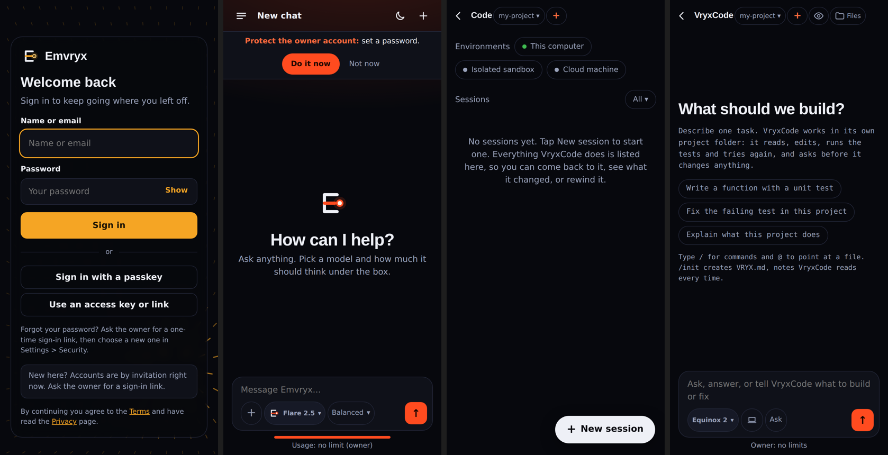

# Emvryx on Android: what it would look like, and how to get there

## What you already have (today, on an Android phone)
Emvryx is already a phone-sized app: the same screens run in Chrome on Android and install to the home screen (Chrome menu > *Install app*), full screen with its own icon. These are the real screens at Pixel size (412 x 860), not mock-ups:

What an installed web app **cannot** do: show up as a real app in Google Play, send notifications when a coding session finishes, take a share from other apps ("Share to Emvryx"), use a home-screen widget, lock with the fingerprint, or run a model on the phone itself.

## Three ways to make "an actual Android app"
| | What it is | Effort | What you gain | What it costs |
|---|---|---|---|---|
| **A. Trusted Web Activity (Bubblewrap)** | Google's own wrapper: the installed page, packaged as an `.apk`/`.aab`, no browser bar | About a day | A real app icon and Play Store listing, nothing to rewrite, updates the moment the website changes | Still the web app: no push, widgets or on-phone models beyond what Chrome allows |
| **B. Capacitor shell** (the plan in [ROADMAP.md](ROADMAP.md) and [APP.md](APP.md)) | The same web code inside a native app shell, with plug-ins for native features | A few days for the shell, more per feature | Everything in A, plus push notifications, share-to-Emvryx, biometric lock, file picker, and (later) llama.cpp on the phone through a plug-in | An Android project to build and keep (Android Studio) |
| **C. Native Kotlin app** | Rewrite the screens natively | Weeks to months | The best feel and speed | Two codebases to keep in step. Not worth it here |

**Recommendation:** do **A now**, then move to **B** only when a native feature is actually wanted. The app is a *client* of your home PC (or later a server) today, so the shell is thin. B reuses the same pages, so nothing done in A is wasted.

## The staged plan
1. **Shell (A or B), connected mode.** Opens `https://chat.emvryx.app`, shows the Emvryx icon and splash, handles back/forward, and keeps the sign-in session. When the PC is off it shows the existing "Emvryx is off right now" page. **Needs:** a Google Play developer account (one-off US$25) for the store, or none to install the `.apk` on your own phone.
2. **Native touches (B).** Push when a VryxCode session or queued build finishes; "Share to Emvryx" (send a page, text or photo to chat); fingerprint or face unlock; voice input.
3. **On-device models (B, later).** llama.cpp inside the app so Flare 3 (2B, 4-bit) answers with the PC off, labelled as "on this phone". The size and window rules are already written in [APP_SPEC.md](APP_SPEC.md#context-window-and-the-device-check-plan). Flare is the only realistic fit on a phone; the larger models stay on the PC.
4. **Store release.** Privacy and data-safety forms (the privacy page already exists), screenshots, closed testing track with your testers, then public.

## What the app needs from the web code first (small, safe changes)
- A **"connected to"** line (your PC vs on this phone) so it is always clear where an answer came from.
- Push-ready sessions: the server remembers a device token per signed-in device and sends one message when a session ends.
- Safe areas and the Android back button (the current web screens already handle iPhone safe areas).

## Decisions I need from you
1. **Play Store listing, or just an `.apk` for you and your testers?** (The store costs US$25 and adds review steps; an `.apk` sideloads straight away.)
2. **Same name and violet or amber icon?** The chat app is still amber behind the "Violet look" flag.
3. **Push notifications first, or the on-phone model first?** Push is far cheaper and probably what you will notice most.
